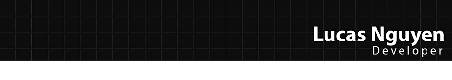

### ABOUT ME
> <b>Full-stack developer. I like to expand my knowledge and deepen my understanding. I value practicality and let my work speak for itself.</b>
#### Contact:
nguyenlucasv@gmail.com
___
### SKILLS
#### Languages:
- Python, C++, HTML, CSS
#### Mobile/Web Dev:
- React, Node.js, Firebase, MongoDB, Expo Go
#### Tooling:
- Github, Docker, WSL, SSH
#### Design and Planning:
- Figma, Trello
___
### PROJECTS

<table>
<thead>
  <tr>
    <th>Project Name</th>
    <th>Description</th>
  </tr>
</thead>
<tbody>
  <tr>
    <td><a href="https://github.com/looka-n/rift-melee" target="_blank" rel="noopener noreferrer">rift-melee</a></td>
    <td>A League of Legends-inspired platform fighter.</td>
  </tr>
  <tr>
    <td><a href="https://github.com/looka-n/mobile-journal" target="_blank" rel="noopener noreferrer">mobile-journal</a></td>
    <td>Minimalist journaling app.</td>
  </tr>
  <tr>
    <td><a href="https://github.com/looka-n/expense-manager" target="_blank" rel="noopener noreferrer">expense-manager</a></td>
    <td></td>
  </tr>
  <tr>
    <td colspan="2" align="center"><a href="https://github.com/looka-n?tab=repositories">View all projects</a></td>
  </tr>
</tbody>
</table>

___
